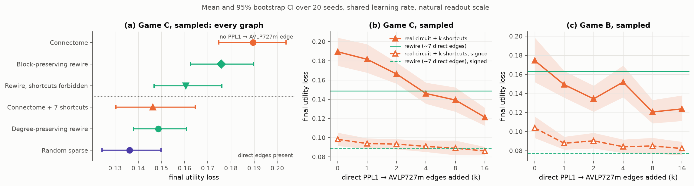
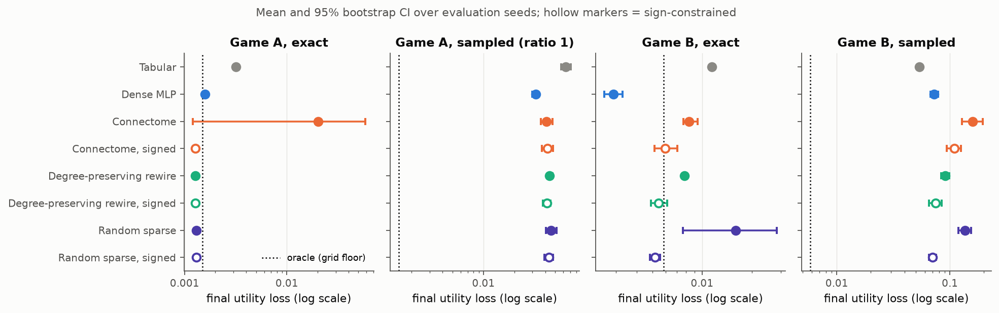
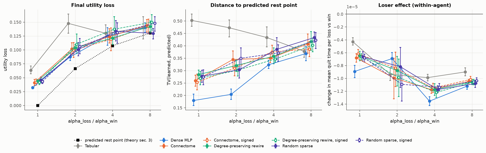
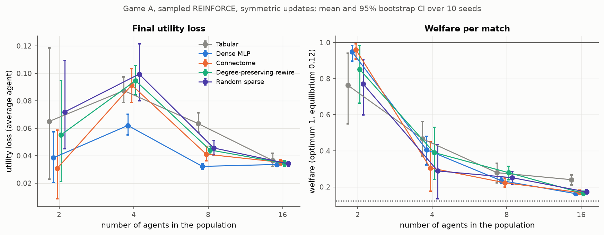
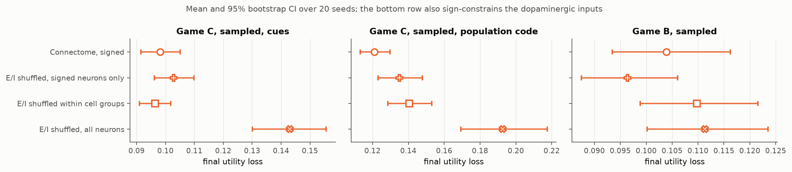

# Fly give-up circuit and the war of attrition

CS329 Foundations of AI: Multi-Agent Systems, IIT Gandhinagar, 2026.  
Project by Suhani, Mayank Choudhary, Krina Paghadar and Nakshatra Lad.

Question: when independent agents learn the war of attrition from their own fights, what
decides how close they get to equilibrium: the learning rule, the number of agents, what
the learner is given, or how its policy network is wired?

The game: two players contest a prize, both pay for every second the contest lasts, and
whoever quits first loses. Male fruit flies fighting over food play it, and Ventimiglia et
al. 2026 found the circuit that makes them give up: PPL1 → V2 MBONs (MBON18/19) →
Tk-GAL4^FruM (AVLP727m). We cut that circuit out of the MaleCNS v1.0 connectome (258
neurons, 4,952 edges) and used it as the policy network of learning agents. It competes
against size-matched networks with the same neurons but different wiring.

- **Agents:** 8 independent learners (2 to 16 in one sweep), each choosing a quitting
  time. They either follow the exact payoff gradient (exact mode) or learn only from the
  fights they play (sampled mode: multi-agent REINFORCE or PPO).
- **Games:**
  - A: complete information.
  - B: private value.
  - C: value is the product of two cues, hunger and food, so the policy has to combine
    them.
- **Controls:**
  - degree-preserving rewire and random sparse graph;
  - a block-preserving rewire that keeps the cell-group layout;
  - the real circuit with direct input→output edges added, and a rewire with them
    forbidden;
  - excitatory/inhibitory label shuffles;
  - dense MLP and look-up table.

  All networks are matched in trainable parameters.
- **Metrics:** exact exploitability (how much a best responder could gain), episodes to
  threshold, and welfare. Contrasts are paired by seed and Holm-corrected.

## Findings

Full numbers are in [RESULTS.md](RESULTS.md); § points there. The report is
[final_report.pdf](final_report.pdf).

1. **The real wiring never helped.** Of 436 distinct wiring contrasts, 32 survive a
   project-wide Holm correction. 26 say the real circuit learns worse. The rest favour it
   by less than 0.001, except one that came from a flawed control (§9).
2. **It is worse where agents learn from sampled fights and the task needs computation.**
   In sampled Game C the real circuit ends worse than the rewire: +0.041 [0.028, 0.054]
   at a shared learning rate (§5).
3. **The cause is a missing shortcut.**
   - The real circuit has no direct PPL1 → AVLP727m edge; size-matched rewires have about
     7.
   - Adding 7 such edges to the real circuit (14 of 4,952 edges changed) closes the gap
     (−0.043, Holm p = 0.029).
   - Exploitability falls steadily with the number added: 0.190 → 0.121 from 0 to 16
     (trend p < 0.0001).
   - A rewire that keeps the circuit's cell-group layout also lacks the shortcut, and is
     about as bad (§6).
4. **The real excitatory/inhibitory labels don't help either**, once the unlabelled
   dopaminergic inputs are left unconstrained (§7).
5. **Other factors matter more than wiring** (§8):

| factor | what we varied | final exploitability |
|---|---|---|
| Learning rule | losses weighted 1, 2, 4, 8 × wins (Game A sampled) | 0.044, 0.107, 0.128, 0.142 (predicted rest point 0, 0.066, 0.108, 0.130) |
| Number of agents | 2, 4, 8, 16 (Game A sampled, connectome) | 0.031, 0.091, 0.041, 0.035 |
| Learning signal | exact gradient vs sampled fights (connectome, Game B) | 0.0083 vs 0.160 |
| Readout | 5 output neurons vs all 258 (Game B exact) | 0.0083 → 0.0028 |
| Wiring | real vs rewire (Game C sampled, shared rate) | 0.190 vs 0.149; real + 7 shortcuts 0.146 |

## Results at a glance

The shortcut mechanism: (a) every graph in sampled Game C, with the graphs that have no
direct input→output edge at the top; (b, c) the real circuit with k shortcuts added.



Final exploitability of every arm in the four main settings:



Weighting losses more than wins moves every arm to the predicted rest point:



The number of agents changes what is learned:



Real vs shuffled excitatory/inhibitory labels:



Other docs: [docs/theory.md](docs/theory.md) (equilibria, exploitability),
[docs/circuit.md](docs/circuit.md) (how the subgraph was extracted),
[hpc/README.md](hpc/README.md) (running everything on a cluster). There's also a small
[browser demo](https://pandasuwu.github.io/Multi_Agent_RL-FAI-/) where you can watch agents
learn with the fly wiring or its controls (`python scripts/build_demo.py`).

## Arms

| # | Arm | Notes |
|---|---|---|
| 0 | Oracle | analytic equilibrium floored onto the grid, used as a check |
| 1 | Tabular | softmax logits per context |
| 2 | Dense MLP | 2 hidden layers, width solved to match the circuit's parameter count |
| 3 | Connectome | recurrent net on the MaleCNS subgraph, one trained weight per real edge, 6 unrolled steps |
| 4 | Rewire | same neurons and in/out degrees, edges shuffled by double-edge swaps, new draw per seed |
| 5 | Random sparse | same neurons and edge count, edges uniform at random |
| 6 | Block rewire | as 4, but swaps only keep edges between the same pair of cell groups |
| 7 | Connectome + shortcuts | real edges plus k direct PPL1 → AVLP727m edges (degree-preserving swaps; k = 7 by default) |
| 8 | Rewire, no shortcuts | as 4, rejecting swaps that create a PPL1 → AVLP727m edge |
| 9 | FlyGM | real synapse counts frozen as weights, neurons trained (Jin et al. 2026), on graphs 3–5 |

Arms 3–8 also have a sign-constrained version (Dale's law, MaleCNS transmitter
predictions); three further variants shuffle those labels. The context goes in through the
16 PPL1 neurons, and the policy comes out of the 5 AVLP727m neurons (or all 258 in the
readout experiments). The runner asserts matched parameter counts before every run.

## Games and training

- Game A: `V = c = 1`, symmetric equilibrium `T ~ Exp(1)`.
- Game B: private values `v ~ Exp(1)`, BNE `b(v) = v²/2`.
- Game C: `v = h·f` with hunger `h ~ Exp(1)` and food `f ∈ {0.5, 1, 1.5, 2}`, BNE by
  quadrature.

Quit times are on a 64-point grid. Exploitability is the ex-ante utility loss of Bichler et
al. 2021, computed exactly on the grid.

- Exact mode: one shared policy follows the exact gradient of its payoff against a
  detached copy of itself.
- Sampled mode: agents are re-matched randomly each round and play 128 matches per round,
  learning by REINFORCE with a running-mean baseline, or by PPO.
- Learning rates are tuned per arm on separate seeds (`configs/tuned_lr.yaml`). Wiring
  contrasts are reported at one shared rate per architecture family.
- 20 seeds in exact mode, and 10 or 20 in sampled mode. Contrasts are paired by seed
  (t-interval, sign-flip permutation p), with Holm correction within each experiment and
  across the project.

## Running it

CPU only, Python 3.10+.

```bash
python -m venv .venv
.venv/Scripts/pip install torch --index-url https://download.pytorch.org/whl/cpu
.venv/Scripts/pip install -r requirements.txt
.venv/Scripts/python -m pytest
```

Everything in RESULTS.md and the report comes from one pipeline:

```bash
.venv/Scripts/python scripts/reproduce_all.py --list         # the steps
.venv/Scripts/python scripts/reproduce_all.py --workers 32   # all of them, from scratch
```

It downloads the MaleCNS files (~566 MB, CC-BY) if needed, tunes learning rates, runs every
experiment, and writes `results/tables/` and `figures/`. The committed results were made
with it on a 48-core cluster node, in stages with `--resume --only <step>`
(`hpc/run_all.slurm`, logs in `hpc/logs/`). In total that is a few days of CPU time. On
Linux/macOS use `.venv/bin/` instead of `.venv/Scripts/`.

To regenerate the tables and figures from the committed runs:

```bash
.venv/Scripts/python scripts/analyze.py
.venv/Scripts/python scripts/make_figures.py
```

## Layout

```
src/games/        payoffs, equilibria (Games A, B, C)
src/agents/       tabular, dense, circuit and FlyGM policies, arm factory
src/connectome/   MaleCNS download and extraction, all control graphs
src/training/     exact and sampled self-play, runner, LR tuning
src/metrics/      exploitability, welfare, paired and bootstrap stats
src/analysis.py   every table behind RESULTS.md
configs/          one YAML per experiment
scripts/          entry points (reproduce_all.py runs everything)
hpc/              SLURM script and cluster logs
data/connectome/  extracted subgraphs and provenance
results/          per-run JSON, summary CSVs, tables
figures/          PNG + PDF
tests/            pytest
```

## References

- Berg, S. et al. Sexual dimorphism in the complete Drosophila male central nervous
  system connectome. Cell 189 (2026). Data CC-BY 4.0.
- Ventimiglia, D. et al. Neural circuits regulating social dominance implement a
  strategy predicted by evolutionary game theory. bioRxiv 2026.02.20.706896.
- Bichler, M., Fichtl, M., Heidekrüger, S., Kohring, N., Sutterer, P. Learning
  equilibria in symmetric auction games using artificial neural networks. Nature
  Machine Intelligence 3, 687–695 (2021).
- Jin, Z., Zhu, Y., Zhang, C., Sui, Y. Whole-brain connectomic graph model enables
  whole-body locomotion control in fruit fly. arXiv:2602.17997 (2026).
