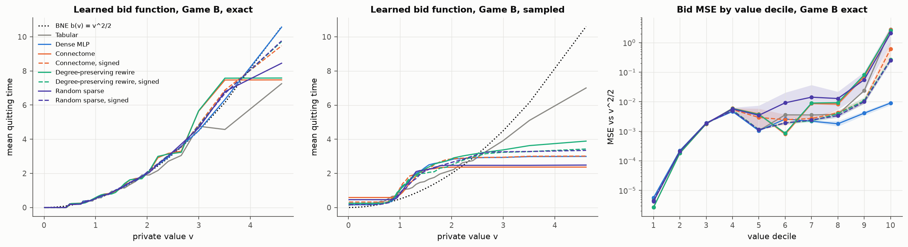
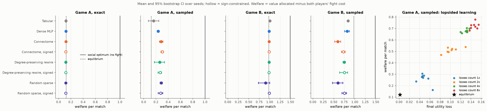

# Results

## Summary

Question: when independent agents learn the war of attrition from their own fights, what
decides how close they get to equilibrium: the learning rule, the number of agents, what
the learner is given, or how its policy network is wired? The wiring factor is the real
fly give-up circuit against size-matched networks wired differently.

Four factors moved the outcome. Wiring did not.

| factor | what we varied | final exploitability | § |
|---|---|---|---|
| Learning rule | losses weighted 1, 2, 4, 8 times wins (sampled Game A, mean of 8 arms) | 0.048, 0.102, 0.130, 0.146 (rest point predicted at 0, 0.066, 0.108, 0.130) | §6, §15.2 |
| Number of agents | 2, 4, 8, 16 (sampled Game A, range over 5 arms) | 0.04–0.08, 0.06–0.11, 0.03–0.07, 0.033–0.035 | §14 |
| Learning signal | exact payoff gradient vs own sampled fights (connectome arm) | Game A 0.0013 vs 0.045; Game B 0.0082 vs 0.154 | §3 |
| Readout | 5 output neurons vs all 258 (Game B exact) | trained edges 0.0082 → 0.0039; frozen synapses 0.33 → 0.011 | §12 |
| Wiring | real circuit vs degree-preserving rewire (Game B exact) | 0.0082 vs 0.0078, difference +0.0004 [−0.0002, 0.0015] | §4 |

### What moved the outcome

- Learning rule. Weighting losses more than wins pushes every arm away from equilibrium
  to the rest point the theory predicts: the equilibrium of a modified game, with a
  Lomax quitting law instead of the exponential. Observed exploitability sits 0.02–0.05
  above the prediction, about the sampling-noise floor. It also amplifies a loser effect
  that wiring doesn't change (§6, §15.2).
- Welfare. The equilibrium wastes almost the whole prize in Game A and only breaks even
  with a coin flip in Game B. Learners that weight losses more than wins quit earlier:
  higher exploitability, almost three times the welfare (§13).
- Population size. A fixed pair usually settles into roles with almost no fight. Four
  agents learn worst. From 8 up the population approaches the symmetric equilibrium,
  and at 16 all arms tie (§14).
- Learning signal. Every arm ends well above its exact-gradient result when it learns
  from sampled fights. In sampled Game B no network arm reaches the 0.05 threshold under
  REINFORCE; PPO gets the dense network and two signed circuits there (§3, §10).
- The readout. Reading the policy from all 258 neurons instead of 5 improves every
  circuit arm in Game B, fixes the collapse of the frozen-synapse (FlyGM) arms, and
  removes the advantage sign constraints had with the 5-neuron readout (§9, §12).
- Architecture class. The dense MLP beats every circuit arm in 3 of 4 settings; the
  circuits only win in Game A exact. This is a comparison at each architecture's own
  tuned rate (§15.4).

### Wiring

We found no effect of fly wiring on final exploitability. In all four settings
(Game A and B, exact and sampled), the policy built on the real circuit ends up where
its two size-matched controls do: a degree-preserving rewire and a random sparse graph.
In the main grid every contrast either has a CI that covers zero or fails Holm. A few
exact-mode gaps pass Holm at a shared rate (§12, §15.4), but they are at most 0.003 in
exploitability (≤ 7%) and point in opposite directions.

How much that null says depends on the setting:

- Game B exact is the fair test. The learners converge and the policy has to depend on
  the input. The 95% CI half-widths on real-minus-control are 10–21% of the arms' own
  loss, so larger effects are ruled out.
- Game A cannot show a wiring effect on the final policy. Its input is a constant, so
  the 64 output biases can represent any policy whatever the graph, and the tight
  intervals there (3–11% of the loss) would be tight for any wiring. Wiring can only
  change the path, which is where the one Game A effect is (speed, below).
- Sampled mode has 10 seeds and half-widths of 13–29%. In sampled Game B the learners
  have not converged, and an effect of a quarter of the loss in either direction would
  not have been seen (§4, §8).

Game B exact, 20 seeds, final exploitability, mean [95% CI]:

| arm | unsigned | sign-constrained |
|---|---|---|
| real connectome | 0.0082 [0.0077, 0.0093] | 0.0060 [0.0051, 0.0070] |
| degree-preserving rewire | 0.0078 [0.0078, 0.0079] | 0.0052 [0.0049, 0.0056] |
| random sparse | 0.064 [0.009, 0.146]† | 0.0054 [0.0049, 0.0062] |
| connectome − rewire | +0.0004 [−0.0002, 0.0015] | +0.0007 [−0.0002, 0.0019] |

†Tuned to a rate of 0.03, where three of 20 seeds ended far from equilibrium. At a
shared rate of 0.01 it ends at 0.0076 (§15.4).

Where wiring did show up:

- Stability, the largest effect. In Game B exact at a learning rate of 0.03, three times
  its tuned rate, the unsigned real circuit reaches the threshold in 7 of 20 seeds,
  against 15 for the rewire and 16 for random (§4). At its own tuned rate, and with sign
  constraints, there is no such gap.
- Speed, small and in both directions. In Game A exact the unsigned connectome reaches
  the threshold 15–20 episodes before its controls (§11). In Game B exact the signed
  connectome is 45–50 episodes slower than its signed controls.
- High-value bids. In Game B exact the signed real circuit bids worse for the
  highest-value types (top-decile bid MSE 0.99 vs 0.24 and 0.28). The payoff is almost
  flat there, so it barely shows in exploitability (§4).
- Under PPO one Game B contrast passes Holm within its own experiment but not across
  the whole project, so we treat it as suggestive (§10).

Checks added after the project review (§15) leave the wiring conclusions unchanged: the
population as a whole is further from Nash than each agent against the others; the
loss-weighted rest point matches simulations of the learning rule; every control graph
keeps all PPL1 → AVLP727m paths; and a full shared learning-rate sweep finds no wiring
effect beyond the Game A speed-up.

---

## 1. Setup

| | |
|---|---|
| Arms | oracle, tabular, dense MLP (5,584 params), connectome, degree-preserving rewire, random sparse (5,610 params each; ±Dale's-law sign constraint) |
| Circuit | MaleCNS v1.0: PPL1 (16) → MBON18/19 (6) → AVLP727m = Tk-GAL4^FruM (5), with 54 path neurons and 177 one-hop partners; 258 neurons and 4,952 edges ([docs/circuit.md](docs/circuit.md)) |
| Games | A: `V = c = 1`, NE `Exp(1)`. B: `v ~ Exp(1)`, BNE `v²/2`. 64-point grids ([docs/theory.md](docs/theory.md)) |
| Exact mode | one shared policy, exact expected-payoff gradient; 20 seeds; 3,000 (A) or 4,000 (B) episodes |
| Sampled mode | 8 independent agents (2 to 16 in §14), randomly re-matched, 128 matches per agent per episode, REINFORCE with baseline; 10 seeds; 3,000 episodes; `α_loss/α_win ∈ {1, 2, 4, 8}` (Game A) |
| Welfare | value allocated minus both players' fight cost, against the social optimum of no fight (§13) |
| Primary metric | exact ex-ante utility loss (exploitability) on the grid, Bichler et al. 2021 conventions, absolute units (Game A equilibrium payoff = 0) |
| Threshold | 0.01 (exact), 0.05 (sampled); time to threshold censored at the training length |
| Statistics | mean with 95% percentile bootstrap CI (10,000 resamples). Each contrast: bootstrap CI of the difference, Hedges' g, permutation p, Holm-adjusted within each experiment × metric family. "Distinguishable" = CI excludes 0 and Holm p < 0.05. |

Tables are in `results/tables/`; per-run records with the full config and seed are in
`results/<experiment>/runs/`. Theory is in [docs/theory.md](docs/theory.md), the circuit
in [docs/circuit.md](docs/circuit.md).

## 2. Sanity checks

- Oracle: grid exploitability 0.00149 in Game A and 0.0058 in Game B. These are the
  discretisation floors.
- Tabular, Game A exact: converges to 0.0032, and its learned survival curve lies on
  `exp(−t)` (`figures/fig1_*`).
- `b(v) = v²/2` is a best response to itself, confirmed by quadrature
  (`tests/test_games.py`).
- Parameter counts are matched within 0.5%, and every rewired control preserves every
  in- and out-degree. Both are asserted before every run.

## 3. Final exploitability by arm

Mean [95% CI]; seeds in brackets. `figures/fig3_main_comparison.png` has every experiment.

| arm | A exact (20) | A sampled, ρ=1 (10) | B exact (20) | B sampled (10) |
|---|---|---|---|---|
| oracle | 0.00149 | 0.00149 | 0.0058 | 0.0058 |
| tabular | 0.00318 | 0.065 [0.056, 0.077] | 0.0095 | 0.053 [0.051, 0.054] |
| dense MLP | 0.00159 [0.00157, 0.00160] | 0.033 [0.031, 0.037] | 0.0029 [0.0026, 0.0033] | 0.072 [0.061, 0.084] |
| connectome | 0.00127 [0.00118, 0.00144] | 0.045 [0.042, 0.049] | 0.0082 [0.0077, 0.0093] | 0.154 [0.133, 0.171] |
| connectome, signed | 0.00127 [0.00125, 0.00130] | 0.045 [0.041, 0.049] | 0.0060 [0.0051, 0.0070] | 0.094 [0.088, 0.101] |
| rewire | 0.00127 [0.00126, 0.00128] | 0.057 [0.050, 0.065]* | 0.0078 [0.0078, 0.0079] | 0.095 [0.088, 0.102]* |
| rewire, signed | 0.00125 [0.00122, 0.00128] | 0.047 [0.042, 0.052] | 0.0052 [0.0049, 0.0056] | 0.090 [0.070, 0.121] |
| random sparse | 0.00130 [0.00128, 0.00133] | 0.049 [0.043, 0.056] | 0.064 [0.009, 0.146]† | 0.143 [0.116, 0.172] |
| random sparse, signed | 0.00132 [0.00125, 0.00145] | 0.044 [0.040, 0.048] | 0.0054 [0.0049, 0.0062] | 0.079 [0.068, 0.090] |

\* Tuned to a different learning rate from the connectome (§5). †Three of 20 seeds ended far from equilibrium.

Circuit arms in Game A exact sit below the oracle because they learn the exact grid
equilibrium, which the floored analytic law only approximates.

## 4. Real wiring vs controls

Final exploitability, connectome minus control, 95% CI (Holm p). Negative means the
connectome is better.

| setting | vs rewire (unsigned) | vs rewire (signed) | vs random (unsigned) | vs random (signed) |
|---|---|---|---|---|
| A exact | +0.000002 [−0.00009, 0.00018] (1.0) | +0.00002 [−0.00002, 0.00006] (1.0) | −0.00003 [−0.00013, 0.00015] (1.0) | −0.00005 [−0.00018, 0.00003] (1.0) |
| A sampled, shared lr | +0.0004 [−0.0054, 0.0061] (1.0) | −0.0015 [−0.0082, 0.0050] (1.0) | −0.0031 [−0.0109, 0.0038] (1.0) | +0.0010 [−0.0052, 0.0069] (1.0) |
| B exact | +0.0004 [−0.0002, 0.0015] (1.0) | +0.0007 [−0.0002, 0.0019] (0.76) | −0.056 [−0.140, −0.002] (0.22) | +0.0005 [−0.0007, 0.0018] (1.0) |
| B sampled, shared lr | −0.027 [−0.069, 0.012] (0.92) | +0.004 [−0.027, 0.026] (1.0) | +0.011 [−0.025, 0.044] (1.0) | +0.015 [0.003, 0.028] (0.22) |

No cell is distinguishable from zero. One cell is not at a matched rate: in B exact the
unsigned connectome and rewire both tuned to 0.01, but the unsigned random graph tuned
to 0.03. At a matched 0.03 the connectome ends worse than both controls on final
exploitability too (0.165 against 0.050 and 0.064), because of the seeds that do not
converge: +0.115 [0.005, 0.265] vs rewire (Holm p = 0.44) and +0.101 [−0.035, 0.259] vs
random (Holm p = 0.92). At a matched 0.01 the three end at 0.0086, 0.0078 and 0.0076
(§15.4).

Speed and secondary metrics that *are* distinguishable at a matched learning rate:

| setting | contrast | effect | Holm p |
|---|---|---|---|
| A exact | connectome − rewire (unsigned), episodes to 0.01 | −19 [−24, −14] (g = −2.2) | 0.001 |
| A exact | connectome − random (unsigned), episodes to 0.01 | −24 [−28, −20] (g = −3.3) | 0.001 |
| A exact | same contrasts, signed | +15 [5, 25] and +10 [0, 20] | 0.08 / 0.36, not distinguishable |
| B exact | connectome − random (signed), episodes to 0.01 | +50 [18, 83] (g = 0.94) | 0.035 |
| B exact | connectome − rewire (signed), episodes to 0.01 | +45 [17, 75] (g = 0.89) | 0.050 (0.036 in the shared-lr run) |
| B exact | connectome − rewire (signed), bid L2 | +0.109 [0.039, 0.189] (g = 0.85) | 0.022 |
| B sampled | connectome − random (signed), bid L2 | +0.227 [0.102, 0.341] (g = 1.5) | 0.025 |
| B exact, shared lr 0.03 | connectome − rewire (unsigned), episodes to 0.01, censored at 4,000 | +1,425 [465, 2,303] (g = 0.91); 7 of 20 seeds reach it vs 15 | 0.036 |
| B exact, shared lr 0.03 | connectome − random (unsigned), episodes to 0.01, censored at 4,000 | +1,500 [555, 2,370] (g = 1.0); 7 of 20 vs 16 | 0.029 |

- Game A exact: a small speed-up for the unsigned connectome that vanishes under sign
  constraints (§11).
- Game B exact, signed: a small slow-down and worse bids for the highest values (top
  decile bid MSE 0.99 vs 0.24 and 0.28). The payoff is nearly flat there, so it barely
  moves exploitability.
- Game B exact, unsigned, at lr 0.03 (three times the connectome's tuned rate): the real
  circuit is less stable, 7 of 20 seeds reaching the threshold against 15 and 16. At a
  shared rate of 0.01 the three graphs end within 12% of each other (§15.4).

## 5. Learning-rate confound

Per-arm tuning gave the unsigned rewire a rate 10× higher than the connectome in sampled
Game A and 3× lower in sampled Game B. At those rates two "wiring" contrasts looked
significant (Game B sampled: connectome worse by +0.059, Holm p = 0.004). We re-ran the
circuit arms at one shared rate (`configs/robust_*_shared_lr.yaml`) and both disappear:

- Game B sampled: −0.027 [−0.069, 0.012].
- Game A sampled: +0.0004 [−0.0054, 0.0061].

The exact-mode speed effects of §4 were measured at a shared rate from the start and
remain. We treat only effects that survive both protocols as real.

## 6. Asymmetric win/loss updates and the loser effect (sampled Game A)

With losses weighted ρ times more than wins, REINFORCE converges to the equilibrium of a
*modified* game (docs/theory.md §3): more immediate quits, a heavy tail, and an
exploitability floor.

| ρ = α_loss/α_win | 1 | 2 | 4 | 8 |
|---|---|---|---|---|
| predicted exploitability of the rest point | 0 | 0.066 | 0.108 | 0.130 |
| observed final exploitability (mean of 8 arms) | 0.048 | 0.102 | 0.130 | 0.146 |

- Every arm's exploitability rises with ρ (every increase over ρ = 1 has Holm p ≤ 0.004).
  Observed values sit 0.015–0.05 above the prediction, about the sampling-noise floor.
- No wiring contrast at any ρ is distinguishable.
- Loser effect. Losing lowers an agent's next-round quitting time in every arm, even at
  ρ = 1. Loss-weighting amplifies it about 1.8×. Wiring does not change it: at a shared
  rate every connectome-vs-control difference has a CI that includes 0.

So the agents show a loser effect of the fly kind, but it comes from the learning rule
and not from the fly wiring.

## 7. Other findings

- Sign constraints help all three circuit graphs in Game B with the 5-neuron readout
  (all Holm p ≤ 0.016), and not in Game A. With the all-neuron readout the advantage is
  gone (§12).
- Dense vs circuit. Dense is better in A sampled (0.033 vs 0.045), B exact (0.0029 vs
  0.0060) and B sampled (0.072 vs 0.094). The circuits are better and faster in A exact
  (0.00127 vs 0.00159; 226 vs 341 episodes). Most of the Game B gap is the 5-neuron
  readout (§12).
- No arm orbits the equilibrium: late-training policy variance in exact mode is below
  2·10⁻⁶.

## 8. Limitations

- Game A has a single, constant context. The 64 output biases alone can represent any
  policy, so wiring cannot change which policies are reachable there, only the path to
  them. Game B exact is the only setting that tests wiring on a converged, input-dependent
  policy.
- The games ask little of the network: one constant input in Game A, one number in
  Game B. A circuit whose wiring matters for structured sensory input would not show it
  here.
- Sampled REINFORCE does not converge closely. It stalls at 0.03–0.05 in Game A, and in
  Game B no network arm reaches the 0.05 threshold, so those wiring contrasts compare
  learners that have not converged.
- Statistical power. With 10 seeds the sampled intervals are wide, so "no effect found"
  there rules out large effects only.
- Tuning. Learning rates were tuned on 2 seeds per grid point, and several sit on a grid
  edge (dense in A sampled, tabular in both sampled games, more under PPO).
- The tests are unpaired although arms share seed numbers. The across-arm correlation of
  per-seed final exploitability has a median of 0.02 to 0.10 in the four main settings,
  so a paired test would gain little.
- The shared learning-rate sweep (§15.4) covers exact mode only.
- One circuit definition: one synapse threshold, one unroll depth (6), PPL1 as input and
  AVLP727m as output. Sensitivity to these was not tested. Transmitter signs are
  predictions, and 26 of 258 neurons have none.
- Independent learners partly specialise, so per-agent exploitability understates how
  far the population is from equilibrium (§15.1).
- Not run: FlyGM under PPO in Game B, loss-weighting under PPO, and welfare for the PPO
  and FlyGM sampled runs.
- Some runs (§14, §15, part of FlyGM Game B sampled) were made on a different machine
  and torch version and reproduce to about 0.01 on single seeds, not bit for bit.

---

## 9. FlyGM: frozen synapse weights

The circuit arms above keep the *shape* of the fly circuit and learn every edge weight.
The FlyGM arms (after Jin et al. 2026) keep the real synapse counts as fixed weights,
scaled to spectral radius 1, and train the neurons instead: a 9-number description per
neuron and one small update network shared by all 258. Parameters are matched (5,638
against 5,610). The same is done on the rewired and random graphs.

| graph | spectral radius before scaling | input to output gain |
|---|---|---|
| real circuit | 1,230.4 | 0.0079 |
| degree-preserving rewire | 373 to 922 (varies by seed) | 1.4 to 23.3 (median 10.9) |
| random sparse | 368 to 511 (varies by seed) | 2.2 to 20.9 (median 8.8) |

The gain is how much of a signal put into the input neurons arrives at the output
neurons within the 6 steps. The real circuit passes 180 to 2,900 times less than its
controls.

**Game A** works, with no wiring effect (largest contrast has Holm p = 1.0). The speed-up
the real circuit has with trained edges (§11) is gone with frozen synapses. In sampled
mode the three graphs also tie (0.044, 0.040, 0.044).

| arm | final loss | episodes to 0.01 |
|---|---|---|
| FlyGM, real circuit | 0.001398 [0.001363, 0.001433] | 262.5 |
| FlyGM, rewire | 0.001396 [0.001361, 0.001431] | 263.8 |
| FlyGM, random sparse | 0.001391 [0.001357, 0.001428] | 262.5 |
| oracle (the grid floor) | 0.001488 | n/a |

**Game B** collapses to a constant bid.

| arm | final loss | seeds reaching the 0.01 threshold |
|---|---|---|
| FlyGM, real circuit | 0.3311 [0.33112, 0.33114] | 0 of 20 |
| FlyGM, rewire | 0.3290 | 0 of 20 |
| FlyGM, random sparse | 0.3263 | 0 of 20 |
| connectome, trained edges | 0.0082 | 19 of 20 |
| dense MLP | 0.0029 | 20 of 20 |

Mean quitting time each arm chooses for the smallest and the largest value (it should
rise with the value):

| arm | at the smallest value | at the largest value | seeds whose bid varies with `v` | correlation with `b(v)` |
|---|---|---|---|---|
| FlyGM, real circuit | 0.921 | 0.921 | 0 of 20 | undefined (constant bid) |
| FlyGM, rewire | 0.907 | 0.963 | 1 of 20 | undefined for the other 19 |
| FlyGM, random sparse | 0.908 | 0.987 | 1 of 20 | undefined for the other 19 |
| connectome, trained edges | 0.002 | 7.489 | 20 of 20 | 0.96 |
| dense MLP | 0.000 | 10.567 | 20 of 20 | 1.00 |
| correct answer, `b(v) = v²/2` | 0.000 | 10.604 | n/a | 1.00 |

- 58 of 60 runs bid the same for every value. Sampled mode does the same on all 30 runs
  (final loss 0.26–0.28).
- The input does enter the network, but the 5 readout neurons end up pinned at ±1 of
  the tanh for every value, and then almost no gradient reaches anything upstream.
- Weak synapses are not the cause: the controls collapse too, with far more gain. §12
  shows the cause is the readout.
- So the Game B rows say nothing about wiring, and should not be compared with the
  other arms as they stand.

In Game A exact, FlyGM matches the trained-edge connectome on final loss, is 36 episodes
slower, and beats the dense MLP.

Caveat: for Game B sampled, learning rates were screened on 1,000 steps but the runs are
3,000, and the runs overshoot (best about 0.24, final about 0.28). A full-length check at
a lower rate ends in the same place, so this is not what holds the arm back.

---

## 10. PPO instead of REINFORCE

PPO reuses each batch of 128 matches for 4 clipped updates (epsilon 0.2) instead of 1,
with the same baseline and no entropy bonus (`training.sampled_algorithm: ppo`).

Episodes to threshold, 10 seeds, censored at 3,000:

| arm | Game A, REINFORCE | Game A, PPO | Game B, REINFORCE | Game B, PPO |
|---|---|---|---|---|
| dense MLP | 720 | 460 | 3,000 | 1,860 |
| connectome | 695 | 175 | 3,000 | 3,000 |
| connectome, signed | 680 | 160 | 3,000 | 2,675 |
| rewire | 1,030 | 450 | 3,000 | 3,000 |
| random sparse | 690 | 450 | 3,000 | 3,000 |
| random sparse, signed | 710 | 155 | 3,000 | 2,350 |
| FlyGM, real circuit | 715 | 460 | n/a | n/a |
| tabular | 425 | 975 | 2,890 | 3,000 |

Final utility loss; * marks a distinguishable change:

| game | arm | REINFORCE | PPO | change |
|---|---|---|---|---|
| A | tabular | 0.0655 | 0.0351 | -0.0304 * |
| A | dense MLP | 0.0333 | 0.0338 | +0.0004 |
| A | connectome | 0.0454 | 0.0636 | +0.0182 |
| A | connectome, signed | 0.0451 | 0.0596 | +0.0145 * |
| A | rewire | 0.0568 | 0.0503 | -0.0064 |
| A | FlyGM, rewire | 0.0396 | 0.0544 | +0.0148 * |
| B | tabular | 0.0529 | 0.0811 | +0.0282 * |
| B | dense MLP | 0.0716 | 0.0491 | -0.0225 * |
| B | connectome, signed | 0.0942 | 0.0564 | -0.0379 * |
| B | random sparse, signed | 0.0790 | 0.0510 | -0.0280 * |
| B | connectome | 0.1536 | 0.1364 | -0.0172 |

- Speed: every network arm reaches the threshold sooner in Game A, up to 4 times sooner.
  In Game B, dense and two signed circuits now reach it.
- Final loss: PPO helps where the limit is how fast the policy can move (Game B) and
  hurts where the limit is sampling noise at a mixed equilibrium (Game A).
- Tabular is slower under PPO, but its rate sits on a grid edge in both games.

Wiring contrasts, re-run at one shared rate per family:

| contrast | at each arm's own rate | at one shared rate | verdict |
|---|---|---|---|
| A sampled, connectome signed minus rewire signed | +0.0159, Holm p = 0.021 | +0.0139, Holm p = 0.205 | does not survive |
| B sampled, connectome signed minus rewire signed | -0.0294, Holm p = 0.039 | +0.0049, Holm p = 0.710 | gone, and the sign flips |
| B sampled, connectome minus random sparse | +0.0417, Holm p = 0.009 | +0.0417, Holm p = 0.008 | survives the shared rate; suggestive only across the project (below) |

- The first two were the §5 confound again.
- The third has no rate confound. The real circuit ends worse than random wiring by
  +0.0417 [0.022, 0.061]; against the rewire it is not distinguishable (Holm p = 0.20).
- We treat it as suggestive. It passes Holm within its experiment, but across all 108
  wiring contrasts in the project (`results/tables/wiring_familywide.csv`) it gets Holm
  p = 0.14. No wiring contrast at a shared rate passes family-wide Holm.

## 11. Game A speed-up at full time resolution

§4's speed-up was measured with evaluation every 25 episodes. Rerunning Game A exact with
evaluation every episode (`configs/game_a_exact_eval1.yaml`) gives the same training
trajectories observed more often, so the comparison is exactly paired. Differences in
episodes to 0.01, 95% CI [Holm p]:

| contrast | `eval_every: 1` | `eval_every: 25` (§4) |
|---|---|---|
| connectome − rewire | −15.1 [−18.4, −11.7], g = −2.7 [0.001] | −18.8 [−23.8, −13.8] [0.001] |
| connectome − random sparse | −20.1 [−25.1, −15.6], g = −2.5 [0.001] | −23.8 [−27.5, −20.0] [0.001] |
| connectome − dense | −110.8 [−114.6, −106.9] [0.001] | −115.0 [−120.0, −108.8] [0.001] |
| connectome, signed − rewire, signed | +12.2 [3.1, 21.7] [0.094], not distinguishable | +15.0 [5.0, 25.0] [0.084] |
| connectome, signed − random, signed | +10.6 [2.0, 19.8] [0.122], not distinguishable | +10.0 [0.0, 20.0] [0.355] |
| connectome, signed − connectome | +23.0 [14.8, 31.9] [0.001] | +25.0 [16.3, 33.8] [0.001] |

The speed-up is real and about a fifth smaller than the coarse grid suggested: 15 and 20
episodes out of about 217. It is a speed result only (final exploitability is identical),
and it does not appear with sign constraints.

## 12. Fixing the FlyGM collapse: wider readout vs gain on W

Two fixes, each testing one explanation of §9:

- a trainable gain on `W`, if the frozen synapses are too weak;
- a readout from all 258 neurons through a rank-4 map, if the problem is where the
  policy is read from. Parameter counts are re-matched (6,578), and the dense and
  trained-edge arms get the same readout.

Game B exact, final exploitability, 20 seeds:

| arm | 5-neuron readout (§9) | gain on `W` | readout from all 258 neurons |
|---|---|---|---|
| FlyGM, real circuit | 0.3311 | 0.3311 [0.33112, 0.33113] | 0.0114 [0.0109, 0.0121] |
| FlyGM, rewire | 0.3290 | 0.3222 [0.3041, 0.3314] | 0.0189 [0.0115, 0.0298] |
| FlyGM, random sparse | 0.3263 | 0.3293 [0.3256, 0.3313] | 0.0183 [0.0112, 0.0310] |

- The wider readout removes the collapse (Holm p = 0.002 on every graph). All 60 FlyGM
  seeds now bid by value, against 2 of 60 before.
- The gain does nothing; the learned gain stays near 1.
- Fixed, FlyGM is still worse than the trained-edge connectome (+0.0075) and dense
  (+0.0090), and its bids cover about 6 of the 10.6 units the correct answer spans.
- Still no wiring effect inside FlyGM (both contrasts Holm p = 1.0).

The 5-neuron readout was also holding back the trained-edge arms:

| arm | 5-neuron readout (§3) | all neurons | change |
|---|---|---|---|
| connectome | 0.0082 | 0.0039 | −0.0043 [−0.0057, −0.0031], p = 0.002 |
| connectome, signed | 0.0060 | 0.0031 | −0.0029 [−0.0040, −0.0019], p = 0.002 |
| rewire | 0.0078 | 0.0041 | −0.0037 [−0.0050, −0.0015], p = 0.002 |
| rewire, signed | 0.0052 | 0.0030 | −0.0022 [−0.0026, −0.0018], p = 0.002 |
| random sparse | 0.0639 | 0.0031 | −0.061 [−0.145, −0.007], p = 0.002 |
| random sparse, signed | 0.0054 | 0.0029 | −0.0025 [−0.0033, −0.0019], p = 0.002 |
| dense MLP | 0.0029 | 0.0024 | −0.0005 [−0.0009, −0.0001], p = 0.018 |

- The circuit arms now nearly match dense.
- No wiring contrast survives (all six Holm p = 1.0).
- The sign-constraint advantage of §7 is gone (all three Holm p = 1.0).

In Game A the wider readout lowers every arm by 0.0002 to 0.0005 and the gain again does
nothing. Three trained-edge wiring contrasts favour the connectome there, by 1 to 2.5%
of the loss.

Caveats: the new readout sees the 16 input neurons directly, which could dilute a wiring
effect (a readout excluding them was not run), and only rank 4 was tried.

## 13. Equilibrium vs the social optimum

Welfare is per match, both players together: the value of the prize to whoever gets it,
minus both players' fight cost. The fight produces nothing, so the optimum is no fight.

- Game A: optimum 1. The equilibrium burns the whole prize (0.119 is kept on the grid).
- Game B: optimum 1.486. The equilibrium sorts the prize almost perfectly but pays 0.50
  in fight cost, so welfare is 0.976, the same as a coin flip with no fight.

For sampled runs welfare is the mean over pairs of two *different* agents, obtained by
retraining each run from its stored configuration (`scripts/welfare_rerun.py`). The PPO
and FlyGM sampled runs were not retrained and are absent.

| setting | equilibrium | learners (range of arm means) | direction |
|---|---|---|---|
| Game A, exact | 0.119 | 0.119 to 0.122 | at equilibrium |
| Game A, sampled | 0.119 | 0.16 to 0.31 | every arm wastes less than equilibrium |
| Game B, exact | 0.976 | 0.90 to 1.01 | at equilibrium |
| Game B, sampled | 0.976 | 0.59 to 0.84 | all arms waste more |

- Game A sampled: learners quit a little early, which is what society wants, so they
  keep two to two and a half times the equilibrium's share.
- Game B sampled: learners both allocate worse and fight longer.

Weighting losses more than wins (§6) trades exploitability for welfare, on every arm:

| α_loss / α_win | mean welfare | mean final exploitability |
|---|---|---|
| 1 | 0.26 | 0.048 |
| 2 | 0.51 | 0.102 |
| 4 | 0.68 | 0.130 |
| 8 | 0.72 | 0.146 |

Wiring: of 24 real-vs-control contrasts on welfare at a shared rate, none survives except
two in Game A exact of size 0.0001.

## 14. Number of agents

Game A, sampled REINFORCE, 2, 4, 8 or 16 agents re-matched at random every round, 10
seeds (`configs/popsize_game_a_sampled.yaml`). Each agent plays 128 matches per round at
every size, so only the number of different opponents changes.

Final exploitability of the average agent, mean [95% CI]:

| agents | tabular | dense | connectome | rewire | random sparse |
|---|---|---|---|---|---|
| 2 | 0.081 [0.031, 0.144] | 0.038 [0.019, 0.057] | 0.049 [0.025, 0.075] | 0.072 [0.033, 0.124] | 0.070 [0.037, 0.108] |
| 4 | 0.089 [0.077, 0.104] | 0.064 [0.058, 0.071] | 0.108 [0.080, 0.140] | 0.078 [0.067, 0.090] | 0.108 [0.083, 0.136] |
| 8 | 0.068 [0.059, 0.079] | 0.033 [0.030, 0.036] | 0.045 [0.042, 0.049] | 0.044 [0.040, 0.049] | 0.049 [0.043, 0.056] |
| 16 | 0.033 [0.031, 0.037] | 0.033 [0.031, 0.034] | 0.034 [0.032, 0.037] | 0.035 [0.032, 0.037] | 0.034 [0.032, 0.036] |

Welfare per match between two different agents (optimum 1, equilibrium 0.119):

| agents | tabular | dense | connectome | rewire | random sparse |
|---|---|---|---|---|---|
| 2 | 0.76 [0.57, 0.94] | 0.93 [0.85, 0.99] | 0.88 [0.77, 0.97] | 0.73 [0.48, 0.90] | 0.81 [0.70, 0.91] |
| 4 | 0.51 [0.41, 0.61] | 0.44 [0.36, 0.52] | 0.25 [0.04, 0.44] | 0.44 [0.32, 0.55] | 0.26 [0.06, 0.44] |
| 8 | 0.16 [0.08, 0.24] | 0.24 [0.22, 0.25] | 0.28 [0.26, 0.32] | 0.29 [0.26, 0.31] | 0.29 [0.27, 0.31] |
| 16 | 0.20 [0.18, 0.22] | 0.16 [0.16, 0.17] | 0.16 [0.15, 0.17] | 0.16 [0.15, 0.18] | 0.16 [0.15, 0.17] |

- Two agents split the roles: in 58% of runs one learns to quit at once and the other to
  hold on. That is the asymmetric equilibrium, with hardly any fight, so welfare is
  highest (0.73 to 0.93).
- Four agents are the worst case for every arm.
- From 8 up the population approaches the symmetric equilibrium. The population
  mixture's total-variation distance to it is 0.19–0.28 for the network arms at 8 agents
  and 0.13–0.18 at 16 (tabular 0.53 and 0.29). At 16 every arm reaches 0.033 to 0.035
  and welfare falls towards the equilibrium's 0.12.
- Wiring: 16 tests across sizes, none distinguishable.

---

## 15. Checks after the project review

The TA's review of the project idea raised four points (`make review`).

### 15.1 Population-level Nash

An agent measured against the mixture of the *other* agents can look close to
equilibrium when the population as a whole is not. Game A sampled, 8 agents, shared rate:

| arm | each agent vs the others | population mixture vs itself | each agent's TV to equilibrium |
|---|---|---|---|
| tabular | 0.068 [0.059, 0.080] | 0.097 [0.082, 0.112] | 0.84 [0.82, 0.86] |
| dense | 0.033 [0.030, 0.036] | 0.045 [0.041, 0.048] | 0.42 [0.40, 0.44] |
| connectome | 0.045 [0.042, 0.049] | 0.066 [0.062, 0.070] | 0.59 [0.57, 0.62] |
| connectome, signed | 0.045 [0.041, 0.049] | 0.064 [0.058, 0.071] | 0.58 [0.55, 0.61] |
| rewire | 0.044 [0.040, 0.049] | 0.059 [0.052, 0.066] | 0.56 [0.52, 0.59] |
| rewire, signed | 0.046 [0.041, 0.052] | 0.067 [0.058, 0.075] | 0.58 [0.54, 0.62] |
| random sparse | 0.049 [0.043, 0.056] | 0.066 [0.056, 0.077] | 0.57 [0.54, 0.60] |
| random sparse, signed | 0.044 [0.040, 0.048] | 0.059 [0.052, 0.066] | 0.56 [0.52, 0.59] |

- The mixture's exploitability is 34–47% higher than the per-agent number for every arm:
  the population is a spread of different strategies that only partly averages out.
- No wiring conclusion changes. On the mixture metric no wiring contrast is
  distinguishable at the shared rate (all Holm p ≥ 0.98).
- The gap is largest for a fixed pair and nearly closes at 16 agents
  (`figures/fig13_population_nash.png`).

### 15.2 The shifted equilibrium under loss weighting

The rest point of §6 was derived on paper. `scripts/validate_asymmetric.py` checks it
against simulations of the learning rule that use neither the modified game nor the
formula (`figures/fig11_asym_validation.png`).

| ρ | 1 | 2 | 4 | 8 |
|---|---|---|---|---|
| baseline b: grid fixed point | 0.059 | 0.182 | 0.241 | 0.270 |
| b: sampled rule (mean of 4 seeds) | 0.058 | 0.188 | 0.231 | 0.286 |
| b: closed form | 0 | 0.125 | 0.188 | 0.219 |
| exploitability: grid fixed point | 0.000 | 0.066 | 0.108 | 0.130 |
| exploitability: sampled rule | 0.022 | 0.076 | 0.130 | 0.163 |
| W1, sampled rule to fixed point | 0.074 | 0.064 | 0.089 | 0.099 |
| W1, sampled rule to the true equilibrium | 0.074 | 0.313 | 0.441 | 0.534 |

The derivation holds. The expected dynamics converge to the grid fixed point, and the
sampled rule lands at the shifted point, not at the true equilibrium. The closed form
differs from the grid fixed point by a constant 0.05–0.06 in the baseline, which is the
grid and not the formula.

### 15.3 Do the rewired controls keep the input-output paths?

| | real circuit | rewire (20 graphs) | random (20 graphs) |
|---|---|---|---|
| AVLP727m neurons reachable from PPL1 within 5 synapses | 5 / 5 | 5 / 5 in every graph | 5 / 5 in every graph |
| PPL1 → AVLP727m pairs connected within 5 synapses | 80 / 80 | 80 / 80 in every graph | 80 / 80 in every graph |
| shortest path over all pairs | 2 | 1 | 1 |
| median shortest path | 3 | 2 | 2 |
| log10 number of walks, length 1–5 | 5.76 | 6.22–6.28 | 5.82–6.03 |
| distinct neurons PPL1 synapses onto | 97 | 150–169 | 173–197 |

Every control keeps every PPL1 → AVLP727m path within the 5 synapses the network can
use, and the controls are better connected than the real circuit. So "no wiring effect"
is not because the controls lost their input path.

### 15.4 Shared learning rate vs per-arm tuning

Every network arm at every rate of the exact-mode grid, 10 seeds, Game A and B exact
(`figures/fig12_lr_sweep.png`). Final exploitability, unsigned arms:

| Game | rate | connectome | rewire | random | dense |
|---|---|---|---|---|---|
| A exact | 0.001 | 0.0238 | 0.0239 | 0.0239 | 0.0047 |
| A exact | 0.003 | 0.0135 | 0.0141 | 0.0141 | 0.0016 |
| A exact | 0.01 | 0.0041 | 0.0044 | 0.0044 | 0.98 (diverges) |
| A exact | 0.03 | 0.0013 | 0.0013 | 0.0013 | 0.74 (diverges) |
| B exact | 0.001 | 0.053 | 0.051 | 0.050 | 0.0074 |
| B exact | 0.003 | 0.016 | 0.017 | 0.016 | 0.0040 |
| B exact | 0.01 | 0.0086 | 0.0078 | 0.0076 | 0.0028 |
| B exact | 0.03 | 0.18 (4/10 reach threshold) | 0.071 | 0.018 | 0.027 |

- In every stable setting the three graphs end within 7% of each other in Game A and
  12% in Game B. A few of these gaps pass Holm, in opposite directions, none above 0.003.
- The Game A speed-up of the unsigned connectome holds at two shared rates (Holm
  p = 0.011), so it is a wiring effect and not tuning.
- At 0.03 in Game B the unsigned connectome is unstable (4 of 10 seeds reach the
  threshold, against 8 and 7).
- Dense diverges in Game A at the rates where the circuits do best, so dense-vs-circuit
  numbers are a tuning comparison, not a topology one.
