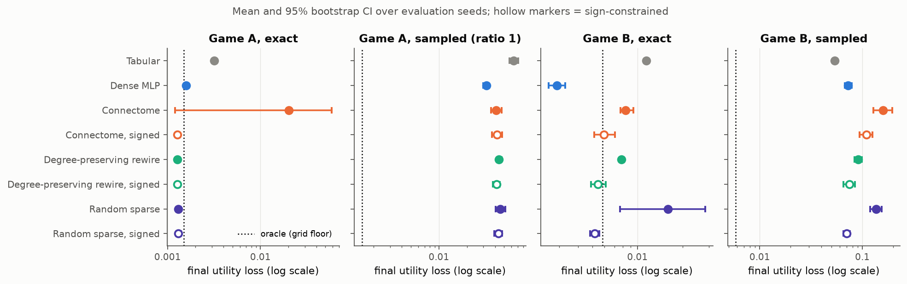
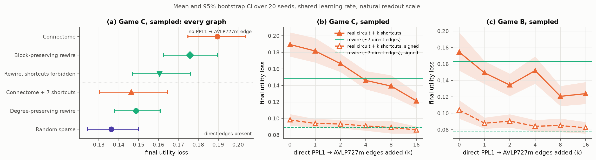
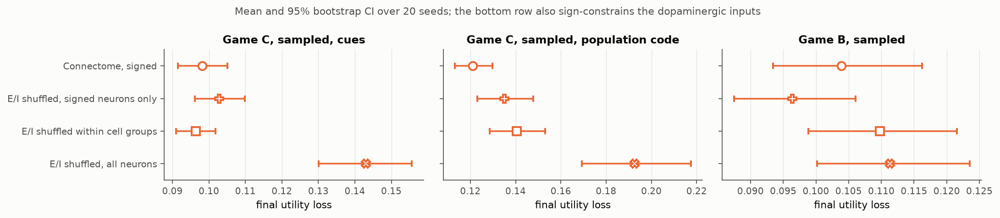

# Results

Every number here is read from `results/tables/` (made by `scripts/analyze.py`) or from
`results/<experiment>/summary.csv`. Runs were made on the PARAM-Ananta cluster with
`scripts/reproduce_all.py` (`results/run_manifest.json`, `results/reproduce_all_log.txt`).

## Summary

Question: when independent agents learn the war of attrition from their own fights, what
decides how close they get to equilibrium? We varied the learning rule, the number of
agents, the learning signal, the readout, and the wiring of the policy network: the real
fly give-up circuit against size-matched networks wired differently.

**The real wiring never helped.** Across 436 distinct wiring contrasts, 32 survive a
project-wide Holm correction. 26 say the real circuit learns *worse* than a control. Of
the other 6, five are smaller than 0.001 in exploitability, and the sixth comes from a
flawed control that we then replaced (§7).

**Where it is worse, the cause is a lack of short input→output connectivity.** The real
circuit has no direct edge from its input neurons (PPL1) to its output neurons (AVLP727m),
and only 9 two-hop routes. A size-matched rewire has about 7 direct edges and 157 two-hop
routes.
- In sampled Game C, the task that needs computation, the real circuit is worse than the
  rewire by +0.041 (paired 95% CI [0.028, 0.054], Holm p = 0.001).
- Adding 7 direct edges to the real circuit (14 of its 4,952 edges changed) removes the
  gap. The real circuit with the shortcuts minus the rewire is −0.002 [−0.024, 0.019].
  Each swap also adds a second edge (c→b), so the treated graph has 45 two-hop routes
  instead of 9 (§6.2).
- Exploitability falls steadily as shortcuts are added: 0.190, 0.182, 0.166, 0.146,
  0.139, 0.121 for 0, 1, 2, 4, 8, 16 shortcuts (trend p < 0.0001, §6). Two-hop routes
  rise with them (9 → 85), but at 16 shortcuts the circuit has fewer two-hop routes than
  the block rewire (85 vs 90) and scores far better (0.121 vs 0.176), so the direct edges
  matter on their own.
- A block-preserving rewire, which keeps the circuit's cell-group layout and so also has
  no shortcut, learns about as badly as the real circuit.

What moved the outcome more than wiring:

| factor | what we varied | final exploitability | § |
|---|---|---|---|
| Learning rule | losses weighted 1, 2, 4, 8 × wins (Game A sampled, mean of 8 arms) | 0.044, 0.107, 0.128, 0.142; predicted rest point 0, 0.066, 0.108, 0.130 | §8 |
| Number of agents | 2, 4, 8, 16 (Game A sampled, connectome) | 0.031†, 0.091, 0.041, 0.035 | §8 |
| Learning signal | exact payoff gradient vs own sampled fights (connectome, Game B) | 0.0083 vs 0.160 | §3 |
| Readout | 5 output neurons vs all 258 (Game B exact) | connectome 0.0083 → 0.0028; FlyGM 0.331 → 0.013 | §8 |
| Wiring | real vs rewire, sampled Game C, shared rate | 0.190 vs 0.149; real + 7 shortcuts 0.146 | §5, §6 |

† At 2 agents the pair settles into asymmetric roles (one quits at once, one holds on),
so low per-agent exploitability does not mean the pair is near the symmetric equilibrium
(population-mixture exploitability is 0.18–0.22 across arms; connectome 0.180).

Scope: one circuit (258 neurons), small policy networks, and a task family where the
exact-gradient learners all converge. In exact mode wiring differences are at most a few
thousandths. The deficit shows up when agents learn from their own sampled fights and the
task needs the two cues of Game C combined.

---

## 1. Setup

| | |
|---|---|
| Arms | oracle, tabular, dense MLP, connectome, degree-preserving rewire, random sparse (each ± Dale's-law sign constraint), FlyGM (frozen synapses); later controls in §6–§7 |
| Circuit | MaleCNS v1.0: PPL1 (16, input) → MBON18/19 (6) → AVLP727m (5, output), 54 path neurons, 177 one-hop partners; 258 neurons, 4,952 edges ([docs/circuit.md](docs/circuit.md)) |
| Games | A: complete information, `V = c = 1`, NE `Exp(1)`. B: private value `v ~ Exp(1)`, BNE `v²/2`. C: `v = h·f` from hunger `h ~ Exp(1)` and food `f ∈ {0.5, 1, 1.5, 2}`, 100 types, BNE by quadrature ([docs/theory.md](docs/theory.md)) |
| Exact mode | one shared policy, exact expected-payoff gradient; 20 seeds |
| Sampled mode | 8 independent agents, randomly re-matched, 128 matches per agent per episode, REINFORCE with baseline (PPO in §8); 10 seeds in the original grids, 20 in every check added after review |
| Metric | exact ex-ante utility loss (exploitability) on the grid; floors 0.0015 (A), 0.0058 (B), 0.0086 (C) |
| Statistics | arms share seeds, so contrasts are paired: Student-t interval on the per-seed differences, sign-flip permutation p (exact up to 16 pairs, 20,000 draws above). Holm within each experiment × sweep point × metric; a project-wide Holm over every wiring contrast (§9) |
| Shared rate | wiring contrasts are reported at one learning rate per architecture family (the family's most common tuned rate), so they are not tuning differences |

## 2. Sanity checks and reproducibility

- Oracle floors as above. Tabular Game A exact converges to 0.0032, and its survival curve
  lies on `exp(−t)` (`figures/fig1_*`).
- Game B and C equilibria are best responses to themselves, checked by independent
  quadrature (`tests/test_games.py`, `tests/test_game_c.py`).
- Parameter counts are matched within 1% and asserted before every run. Every control
  graph keeps every in- and out-degree (tests).
- The whole project was rerun from scratch on the cluster with retuned learning rates
  (torch 2.6). 213 of 267 arm means agree with the earlier run within 0.01. The largest
  differences are at learning rate 0.1 in the rate sweep, where runs diverge either way.
- One Game A exact run diverged late: connectome seed 11 reached the threshold and then
  ended at 0.38. The connectome mean is therefore 0.020 and its median 0.0012.

## 3. Main settings, each arm at its tuned rate

Final exploitability, mean [95% bootstrap CI].

| arm | A exact (20) | A sampled (10) | B exact (20) | B sampled (10) |
|---|---|---|---|---|
| oracle | 0.0015 | 0.0015 | 0.0058 | 0.0058 |
| tabular | 0.0032 | 0.063 [0.057, 0.071] | 0.0115 | 0.054 [0.052, 0.056] |
| dense MLP | 0.0016 [0.0016, 0.0016] | 0.032 [0.030, 0.034] | 0.0029 [0.0026, 0.0033] | 0.073 [0.068, 0.079] |
| connectome | 0.020 [0.0012, 0.058]† | 0.041 [0.036, 0.047] | 0.0083 [0.0077, 0.0094] | 0.160 [0.128, 0.195] |
| connectome, signed | 0.0013 [0.0012, 0.0013] | 0.042 [0.037, 0.048] | 0.0060 [0.0051, 0.0071] | 0.109 [0.094, 0.125] |
| rewire | 0.0013 [0.0013, 0.0013] | 0.044 [0.042, 0.047] | 0.0078 [0.0077, 0.0079] | 0.091 [0.084, 0.099]* |
| rewire, signed | 0.0013 [0.0012, 0.0013] | 0.042 [0.038, 0.045] | 0.0054 [0.0049, 0.0061] | 0.075 [0.065, 0.085] |
| random sparse | 0.0013 [0.0013, 0.0013] | 0.046 [0.041, 0.051] | 0.016 [0.008, 0.028]‡ | 0.137 [0.119, 0.155] |
| random sparse, signed | 0.0013 [0.0013, 0.0014] | 0.043 [0.039, 0.048] | 0.0052 [0.0048, 0.0055] | 0.070 [0.065, 0.075] |

† One diverged seed (§2). \* Tuned to a different rate from the connectome; at the shared
rate it ends at 0.153. ‡ Three of 20 seeds did not reach the threshold.

- Learning from sampled fights costs every network arm more than an order of magnitude in
  exploitability (connectome: Game A 0.0012 → 0.041 by median, Game B 0.0083 → 0.160). In
  sampled Game B no network arm reaches the 0.05 threshold in 3,000 episodes.
- Dense beats the connectome in Game B exact (−0.0054 unsigned, −0.0031 signed, Holm
  p < 0.001) and in Game B sampled. Most of that gap is the 5-neuron readout (§8).
- Sign constraints help every circuit graph in Game B, by about the same amount for real
  and control graphs.

## 4. Wiring in Games A and B

Real circuit minus control, paired, at the shared rate. Negative = real circuit better.

| setting | vs rewire, unsigned | vs rewire, signed | vs random, unsigned | vs random, signed |
|---|---|---|---|---|
| A exact | ns (one diverged seed) | −0.00000 [−0.00003, 0.00003] | ns | −0.00004 [−0.00012, 0.00005] |
| A sampled | −0.003 [−0.009, 0.003] | +0.000 [−0.008, 0.008] | −0.005 [−0.013, 0.004] | −0.001 [−0.006, 0.003] |
| B exact | +0.0005 [−0.0006, 0.0016] | +0.0005 [−0.0007, 0.0018] | −0.008 [−0.019, 0.004] | +0.0008 [−0.0004, 0.0020] |
| B sampled, 10 seeds | +0.007 [−0.032, 0.047] | **+0.035 [0.013, 0.057]**, p = 0.023 | +0.023 [−0.023, 0.069] | **+0.039 [0.020, 0.058]**, p = 0.018 |
| B sampled, 20 seeds | +0.011 [−0.016, 0.039] | **+0.027 [0.013, 0.040]**, p = 0.001 | +0.037 [0.002, 0.071], p = 0.11 | **+0.031 [0.017, 0.045]**, p < 0.001 |

Bold: interval excludes 0 and Holm p < 0.05.

- Game A: final loss cannot show wiring. The input is a constant, so the 64 output biases
  can represent any policy whatever the graph. Wiring changes only the path. The unsigned
  connectome reaches the 0.01 threshold 19 [14, 24] episodes before the rewire and 24
  [19, 28] before random (Holm p = 0.001); with evaluation every episode, 15 and 20
  episodes. With sign constraints the speed-up is gone (the signed connectome is 11
  episodes slower than signed random, Holm p = 0.037).
- Game B exact: nothing distinguishable. The largest gap, −0.008 [−0.019, 0.004] against
  random, comes from three random-sparse seeds that did not converge.
- Game B sampled, signed: the real circuit is worse than both controls with 20 seeds.
  The block control (§6) shows this comes from its cell-group layout, not from its
  neuron-by-neuron wiring.

Checks on these settings, all at shared rates, 20 seeds:

- **Activation scale.** The real circuit's output neurons start 2–3× quieter than the
  controls' (initial readout RMS 0.085 against 0.18 and 0.23 in Game B). We divided the
  readout input by a running RMS (`readout_norm: ema_rms`). Rescaling did not remove
  differences, it made them larger: in Game B exact the real circuit becomes worse than
  the rewire by +0.0049 [0.0025, 0.0073] (Holm p = 0.002) unsigned and +0.0028 signed.
  So the small exact-mode gaps depend on scale, and none favours the real circuit.
- **Where the circuit is cut.** Rebuilding it with a 3-synapse or a 10-synapse threshold
  instead of 5 keeps every real-minus-control difference within 5% of the loss.
- **Unroll depth.** At 4 or 8 steps instead of 6 the differences are at most 0.002.

## 5. Game C: a task that needs computation

In Game C an agent sees hunger `h` and food `f`, and its value is their product. The
equilibrium bid depends on the product, not on either cue alone.
- A bid that ignores food costs 0.058, 6.7× the floor.
- The best additive fit `α(h) + β(f)` to the equilibrium bids costs 0.094, 10.9× the floor.

So near-equilibrium play needs the interaction. Two input codes: the two cues (2 inputs),
or hunger as a 16-neuron population code plus food (17 inputs).

Final exploitability, each arm at its tuned rate:

| arm | exact, cues | exact, pop. code | sampled, cues | sampled, pop. code |
|---|---|---|---|---|
| oracle (floor) | 0.0086 | 0.0086 | 0.0086 | 0.0086 |
| tabular | 0.0108 | 0.0108 | 0.075 | 0.075 |
| dense MLP | 0.0027 | 0.0025 | 0.087 | 0.079 |
| connectome | 0.0072 | 0.0129 | 0.234 | 0.337 |
| connectome, signed | 0.0080 | 0.0125 | 0.098 | 0.121 |
| rewire | 0.0068 | 0.0187 | 0.149 | 0.216 |
| rewire, signed | 0.0060 | 0.0058 | 0.089 | 0.133 |
| random sparse | 0.0068 | 0.0079 | 0.136 | 0.273 |
| random sparse, signed | 0.0049 | 0.0124 | 0.083 | 0.113 |

- Exact learners use both cues the way the equilibrium does. The interaction share of
  the learned bids is 0.26–0.28 against the equilibrium's 0.30, and the correlation with
  the equilibrium bid is 0.93–0.99. Real and control graphs do not differ.
- Exact mode at the shared rates 0.003 and 0.01: real-minus-control differences are
  below 0.0007 at the natural readout scale and 0.0015–0.0053 with rescaling (§6).
- **Sampled mode: the unsigned real circuit is clearly worse.** At its tuned rate it is
  worse than the rewire by +0.086 (cues) and +0.121 (population code), both Holm
  p < 0.001. At the shared rate (0.003) and natural scale the gap is +0.041
  [0.028, 0.054] and +0.052 [0.027, 0.077]. The real circuit also uses food least: its
  learned bid moves with food 0.37× as much as the equilibrium's (cues), against
  0.62–0.65× for the controls.
- Reading the policy from all 258 neurons removes every wiring difference in exact
  Game C (all Holm p = 1.0).
- **Longer training shrinks the gap.** At 15,000 episodes instead of 5,000 (shared rate)
  the unsigned real circuit is still worse than the rewire with cues, +0.021
  [0.005, 0.038] (Holm p = 0.065), and ties it with the population code (−0.004). No
  circuit has converged: every one stays above tabular (0.035), and the unsigned ones
  above dense (0.073).

## 6. Why the real circuit learns worse

### 6.1 Coarse layout, not fine wiring

The **block-preserving rewire** keeps every in- and out-degree and also the number of edges
between every pair of cell groups (PPL1, MBON, path neurons, one-hop partners, AVLP727m). It
shuffles only which neuron connects to which inside a group. So:
- real minus block isolates fine wiring;
- block minus rewire isolates the coarse layout.

| sampled, natural scale, shared rate, 20 seeds | real − rewire | fine: real − block | coarse: block − rewire |
|---|---|---|---|
| Game C, cues | +0.041 [0.028, 0.054] | +0.014 [−0.005, 0.032] | +0.027 [0.010, 0.045], p = 0.039 |
| Game C, cues, signed | +0.009 [0.002, 0.017] | −0.008 [−0.020, 0.004] | +0.017 [0.005, 0.029] |
| Game C, pop. code | +0.052 [0.027, 0.077] | +0.010 [−0.013, 0.032] | +0.042 [0.018, 0.066], p = 0.009 |
| Game B, signed | +0.027 [0.013, 0.040] | −0.011 [−0.030, 0.008] | +0.038 [0.023, 0.052], p = 0.002 |

At the natural scale the fine wiring adds nothing. The deficit is the coarse layout,
which the block rewire shares with the real circuit.
- With rescaling, fine wiring adds a further deficit in sampled Game C: +0.067 [0.036,
  0.097] with cues, +0.063 with the population code.
- With rescaling, exact Game C's small gap is also fine wiring: real − block +0.0016,
  block − rewire 0.0000.

### 6.2 The coarse feature: lack of short input → output paths

Like the real circuit, the block rewire has no PPL1 → AVLP727m edge, so every output is two
or more steps from the inputs. The plain rewire has 7 such edges on average (range 4–10),
and random sparse about 5. In all of them every output stays reachable within the network's
unroll.

Means over the 20 graphs of each family (`results/tables/path_summary.csv`), with final
exploitability in sampled Game C (cues, natural scale, shared rate):

| graph | direct PPL1 → AVLP727m edges | two-hop routes | PPL1 fan-out | shortest path | final exploitability |
|---|---|---|---|---|---|
| real circuit | 0 | 9 | 97 | 2 | 0.189 |
| block-preserving rewire | 0 | 90 | 154 | 2 | 0.176 |
| rewire, shortcuts forbidden | 0 | 151 | 161 | 2 | 0.161 |
| real circuit + 7 shortcuts | 7 | 45 | 101 | 1 | 0.146 |
| degree-preserving rewire | ~7 | 157 | 162 | 1 | 0.149 |
| random sparse | ~5 | 111 | 184 | 1 | 0.136 |

Fan-out (neurons PPL1 synapses onto directly) is not the driver: the shortcut graph keeps
the real circuit's fan-out (101 vs 97) and still closes the gap.

We tested this from both sides:
- `connectome_shortcut`: the real circuit plus 7 direct edges, made by 7
  degree-preserving swaps. 14 edges change; everything else is the real wiring.
- `rewired_noshortcut`: the plain rewire's swap sequence, with any swap that would
  create a direct edge rejected.

Sampled Game C, cues, natural scale, shared rate, 20 seeds:

| contrast | difference | Holm p |
|---|---|---|
| real − rewire (the deficit) | +0.041 [0.028, 0.054] | 0.001 |
| real + 7 shortcuts − real | **−0.043 [−0.068, −0.019]** | 0.029 |
| real + 7 shortcuts − rewire | −0.002 [−0.024, 0.019] | 1.0 |
| rewire, shortcuts forbidden − rewire | +0.012 [−0.008, 0.032] | 1.0 |
| real − rewire, shortcuts forbidden | +0.029 [0.008, 0.050] | 0.084 |

- **Adding shortcuts is enough to close the gap.** Forbidding them in a rewire costs
  only about a third of it (+0.012, p = 1.0), and the real circuit is still worse than
  that no-shortcut rewire (+0.029, p = 0.084). So direct edges are sufficient to close
  the gap, but they are not the whole story: among graphs with no direct edge,
  exploitability falls as two-hop routes increase (9 → 90 → 151 routes: 0.189 → 0.176 →
  0.161). That trend rests on three graph families, and the data cannot separate two-hop
  routes from fan-out, which rise together.
- Within any one family, a graph's connectivity does not predict its run: no per-graph
  Spearman correlation with any connectivity measure survives Holm, in Game B or Game C
  (`results/tables/path_vs_performance.csv`). Graph and initialisation share a seed in
  the controls, so the evidence is the contrast between families, not within them.
- Population code: same direction, weaker. Real + shortcuts − real is −0.030 (p = 0.12),
  and forbidding shortcuts costs the rewire +0.033 (p = 0.12).
- With rescaling, shortcuts still help (−0.068, Holm p = 0.001) but leave a gap to the
  rewire (+0.035, p = 0.077). That is the fine-wiring component of §6.1.

### 6.3 Dose-response

The real circuit with k = 0, 1, 2, 4, 8, 16 direct edges (k = 0 is the real circuit), 20
seeds, natural scale.

| k | 0 | 1 | 2 | 4 | 8 | 16 | slope per doubling of 1 + k |
|---|---|---|---|---|---|---|---|
| Game C, unsigned | 0.190 | 0.182 | 0.166 | 0.146 | 0.139 | 0.121 | −0.018 [−0.022, −0.013], p < 0.0001 |
| Game C, signed | 0.098 | 0.094 | 0.093 | 0.091 | 0.089 | 0.086 | −0.003 [−0.004, −0.001], p = 0.002 |
| Game B, unsigned | 0.174 | 0.149 | 0.134 | 0.152 | 0.121 | 0.124 | −0.012 [−0.019, −0.005], p = 0.002 |
| Game B, signed | 0.104 | 0.088 | 0.090 | 0.084 | 0.085 | 0.082 | −0.005 [−0.007, −0.002], p < 0.001 |

- In Game C every added step improves learning, and from k = 2 the improvement over the
  real circuit is significant (Holm p ≤ 0.036).
- At k = 4 the real circuit matches the rewire (0.149). At k = 16 it beats it.
- Each added shortcut also adds a second edge (c→b), so two-hop routes rise with k:
  9, 14, 20, 30, 50, 85 for k = 0, 1, 2, 4, 8, 16. The dose-response alone cannot tell
  direct edges from two-hop routes. Comparing across families does: k = 16 has fewer
  two-hop routes than the block rewire (85 vs 90) but 16 direct edges, and scores 0.121
  against 0.176. At k = 4 (30 two-hop routes) the circuit already beats both no-direct-edge
  controls (0.146 vs 0.176 and 0.161), although they have 3–5× as many two-hop routes.

## 7. Excitatory/inhibitory labels

With sign constraints, each neuron's outgoing edges carry its predicted transmitter sign.
26 neurons have no prediction and stay unconstrained, including all 16 PPL1 inputs, which
are dopaminergic. We built three label shuffles on the real wiring:
- **all neurons:** the labels, including the unsigned ones, shuffled across all neurons.
  This also constrains most of the PPL1 inputs.
- **signed neurons only:** labels shuffled among signed neurons; the unsigned ones stay
  where they are.
- **within cell groups:** as above, but within each cell group, so each group keeps its
  E/I counts.

Real minus shuffle, sampled, signed, natural scale, 20 seeds:

| setting | all neurons | signed neurons only | within cell groups |
|---|---|---|---|
| Game C, cues | −0.045 [−0.060, −0.029], p < 0.001 | −0.005 [−0.014, 0.005] | +0.002 [−0.008, 0.011] |
| Game C, pop. code | −0.072 [−0.099, −0.044], p < 0.001 | −0.014 [−0.027, −0.001], p = 0.08 | −0.019 [−0.036, −0.003], p = 0.08 |
| Game B | −0.007 [−0.025, 0.010] | +0.007 [−0.006, 0.021] | −0.006 [−0.020, 0.008] |

The large effect in the first column comes from constraining the dopaminergic inputs, not
from the E/I pattern. Once the unsigned neurons stay free, the real labels are no better
than shuffled ones. There is a hint in Game C with the population code that does not
survive correction.

## 8. Other factors

- **Loss-weighted learning (Game A sampled).** Weighting losses ρ times more than wins
  moves every arm away from equilibrium, towards the rest point of a modified game
  ([docs/theory.md](docs/theory.md)). Mean final exploitability over 8 arms: 0.044,
  0.107, 0.128, 0.142 for ρ = 1, 2, 4, 8, against predicted 0, 0.066, 0.108, 0.130.
  Simulating the learning rule without the formula lands on the predicted point
  (`figures/fig11_asym_validation.png`). Losing shortens the next quitting time in every
  arm, a loser effect that comes from the learning rule. No wiring contrast is
  distinguishable at any ρ (`figures/fig4_asymmetric_sweep.png`).
- **Number of agents (Game A sampled).**
  - A fixed pair usually splits into one agent that quits at once and one that holds on.
  - Four agents learn worst for every arm (0.062–0.099). We did not find out why.
  - At 16 every arm reaches 0.034–0.036 (`figures/fig10_population_size.png`).
  - The population as a whole is further from Nash than each agent against the others:
    the mixture's exploitability is 0.056 against 0.041 for the connectome at 8 agents.
- **Readout.** Reading the policy from all 258 neurons (rank-4 map, parameters re-matched)
  instead of the 5 AVLP727m neurons lowers every circuit arm in Game B exact (connectome
  0.0083 → 0.0028), brings them to dense (0.0024), and removes every wiring difference.
- **FlyGM (frozen real synapse counts, trained neurons).**
  - Game A: ties its controls (0.0014).
  - Game B with the 5-neuron readout: collapses to a constant bid (0.331) on every graph,
    including the controls.
  - The all-neuron readout fixes this (0.013), so the collapse comes from the readout,
    not from synapse strength. A trainable gain on the weights did not help.
- **PPO instead of REINFORCE** speeds up every network arm in Game A and gets dense
  (0.048) and the signed circuits closer in Game B. No wiring contrast survives at a
  shared rate under PPO.
- **Welfare.** The equilibrium wastes almost the whole prize in Game A (welfare 0.12 of
  1). Loss-weighted learners quit earlier: welfare 0.24, 0.52, 0.69, 0.73 for ρ = 1, 2,
  4, 8 (`figures/fig9_welfare.png`).

## 9. Project-wide correction

`results/tables/wiring_familywide.csv` holds every wiring contrast on final exploitability
in every experiment and sweep point: 576 rows, 436 after removing exact duplicates (several
check experiments reuse identical runs). One paired Holm correction across all 576 rows,
duplicates included (the smallest attainable p is 576 × 5×10⁻⁵ = 0.029):

- 32 distinct contrasts survive.
- 26 say the real circuit is worse.
- 5 favour it by less than 0.001: Game A exact, and Game B exact at unroll 4.
- 1 favours it by 0.053: the confounded all-neuron sign shuffle (§7).

The shortcut and block contrasts of §6 pass Holm within their experiments, but most do
not survive this project-wide family. The dose-response trend tests (p ≤ 0.002) are
outside it.

## 10. Limitations

- One circuit, one task family, small networks (about 5,600 parameters). The result is
  about how this circuit's layout shapes gradient learning in a policy network, not
  about how flies learn.
- Sampled learners have not converged, even at 15,000 episodes. Part of the deficit is
  learning speed, and it shrinks with training (§5).
- The shortcut test changes 14 edges. It shows that direct input-output edges are enough
  to close the gap; it does not show they are the only feature that matters (forbidding
  them in a rewire recovers only a third of the gap).
- Transmitter signs are predictions. 26 of 258 neurons have none and are unconstrained.
- Learning rates were tuned on 2–3 seeds per grid point. Wiring contrasts are reported
  at shared rates to avoid tuning differences.
- The rerun used torch 2.6 on the cluster. Results reproduce to about 0.01, not bit for
  bit, across machines.
